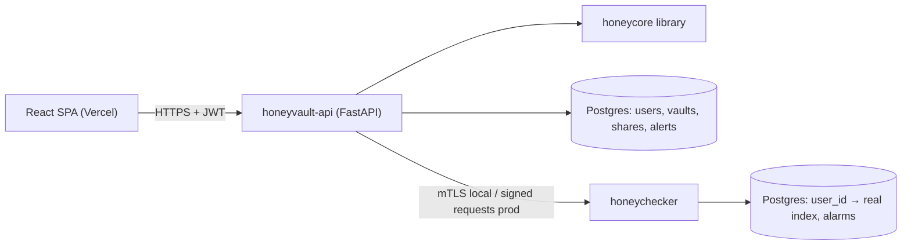

# Architecture

> Owner: T1 lead (Nidhi). Source of truth for the repo tree (PROJECT-ROADMAP.md §3).
> Normative crypto details live in `PROJECT-BRIEF.md` §7–§10.

## 1. System overview


- **honeyvault-api** (`backend/app/`) — auth (JWT + honeywords), vault CRUD, sharing, admin,
  attack demo, evaluation summary. All crypto via `honeycore.factory.load_honeycore(HONEYCORE_IMPL)`.
- **honeycore** (`backend/honeycore/`) — pure library: DTEs (PCFG), Argon2id, AES-256-CTR (no MAC),
  vault blob v1, sigil, baseline vault, ECC sharing, PKI, signed transport. No web/DB imports.
- **honeychecker** (`honeychecker/`) — separate service with its own separate database
  (`HC_DATABASE_URL`); knows only `user_id → real index` and raises alarms. API→honeychecker calls
  are authenticated: signed requests on Render, mTLS in the local compose overlay
  (`docker-compose.mtls.yml`); see ADR-005.
- **frontend** (`frontend/`) — React + TS SPA on the real API; MSW mocks (`VITE_USE_MOCKS=true`)
  are optional, for offline UI work only.

## 2. Honey-vault data flow
```mermaid
flowchart LR
  E["Entry (username, password)"] -->|EntryDTE.encode| S["seed (532 B)"]
  M["master password"] -->|Argon2id + salt| K["K"]
  K -->|HMAC 'honeyvault-enc-v1'| EK["enc_key"]
  K -->|HMAC 'honeyvault-sigil-v1'| SK["sigil_key"]
  S -->|XOR AES-256-CTR(enc_key, nonce)| C["ciphertext (532 B, no MAC)"]
  SK --> SIG["Sigil: 3 emojis + colour"]
```
Unlock reverses it; any password gives some seed, and `decode` is total, so every password yields
a full vault.

## 3. Stub → real swap
`HONEYCORE_IMPL=real` is the default from Phase 2 (`.env.example`); `stub` loads
`honeycore/stubs.py` and is kept for isolated tests (`backend/tests/conftest.py` forces it) and
work without the model files. `load_honeycore("real")` imports the real modules lazily and builds
the bundle once per process:

| Field | Real implementation |
|---|---|
| `entry_dte` | `PCFGEntryDTE.load_default()` — username seed (268 B) ‖ password seed (264 B) |
| `vault_cls` | `HoneyVault.bind(entry_dte)` (Argon2id + AES-256-CTR) |
| `conventional_vault_cls` | `ConventionalVault` (baseline, AES-GCM) |
| `password_model` | the entry DTE's `PCFGPasswordModel` (same loaded instance; honeywords) |
| `sharing` / `pki` | `Sharing()` / `PKI()` |

A missing module raises `NotImplementedError("<module> not implemented yet — owner: <name>")`; a
missing `pcfg_*_v1.json.gz` raises `RuntimeError` naming the file and the `train_pcfg.py` command.
The vault blob shape is identical in both modes; stub blobs say "stub" in `scheme`/model ids, and
both modes use the same sigil tables (`honeycore/sigil.py`).

## 4. Repository tree
Legend: ✅ exists (owner). Ownership follows PROJECT-ROADMAP.md §2.

```text
CNS---Honey-Encryption-Vault/
├── README.md                            ✅
├── PROJECT-BRIEF.md                     ✅ what & why (normative crypto spec)
├── PROJECT-ROADMAP.md                   ✅ who/when, contracts summary
├── CLAUDE.md                            ✅ Claude Code entry point (imports AGENTS.md)
├── .env.example                         ✅ single env file for all services
├── .gitignore                           ✅
├── docker-compose.yml                   ✅ T4 Vedant
├── docker-compose.mtls.yml              ✅ mTLS overlay (ADR-005)
├── render.yaml                          ✅ T4 Vedant (Render: API + honeychecker)
├── .claude/
│   └── settings.json                    ✅ agent permissions (denies git/gh write commands)
├── .github/
│   ├── CODEOWNERS                       ✅ review owners per path (PROJECT-ROADMAP.md §2)
│   ├── PULL_REQUEST_TEMPLATE.md         ✅
│   ├── ISSUE_TEMPLATE/task.md           ✅
│   └── workflows/ci.yml                 ✅ T4 Vedant
├── docs/
│   ├── AGENTS.md                        ✅ rules for AI coding agents
│   ├── api-contract.md                  ✅ FROZEN REST contract
│   ├── architecture.md                  ✅ this file
│   ├── threat-model.md                  ✅
│   ├── demo-script.md                   ✅
│   ├── eval-report.md                   ✅ evaluation results (from eval/results/latest.json)
│   ├── TEAM.md                          ✅ everyone adds a row in P0
│   ├── deployment.md                    ✅ T4 Vedant
│   └── decisions/ADR-001…ADR-007.md     ✅
├── backend/
│   ├── pyproject.toml                   ✅ ruff + pytest config
│   ├── requirements.txt                 ✅ runtime
│   ├── requirements-dev.txt             ✅ tests, lint, eval
│   ├── alembic.ini                      ✅
│   ├── alembic/{env.py,script.py.mako,versions/}   ✅ (T2 Tanuj)
│   ├── Dockerfile                       ✅ T4 Vedant
│   ├── app/                             T2
│   │   ├── main.py · config.py · db.py  ✅ (Tanuj)
│   │   ├── security.py · rate_limit.py · errors.py · deps.py   ✅ app core (Tanuj)
│   │   ├── api/
│   │   │   ├── health.py                ✅
│   │   │   ├── vault.py · attack.py · eval.py             ✅ (Tanuj)
│   │   │   ├── auth.py · admin.py · users.py · shares.py  ✅ (Rohan)
│   │   │   └── utils.py                 ✅ T5 Aryan
│   │   ├── models/core.py               ✅ users/vaults/shares/alerts (Tanuj)
│   │   ├── schemas/                     ✅ auth.py (Rohan) · vault.py (Tanuj) · shares/users (Rohan)
│   │   ├── services/                    ✅ vault_service.py (Tanuj); registration, alerts,
│   │   │                                   honeywords, honeychecker_client, identity_service,
│   │   │                                   share_service (Rohan)
│   │   └── utils/strength.py            ✅ T5 Aryan
│   ├── honeycore/                       T1 (sharing/pki/transport: T4 Parth)
│   │   ├── interfaces.py                ✅ FROZEN contract
│   │   ├── stubs.py · factory.py        ✅ (Nidhi; "real" wiring P2)
│   │   ├── kdf.py · cipher.py · vault.py · baseline.py    ✅ (Dhruv)
│   │   ├── sigil.py                     ✅ (Dhruv)
│   │   ├── sharing.py · pki.py · transport.py             ✅ (Parth)
│   │   ├── dte/
│   │   │   ├── int_codec.py · pcfg.py · password_dte.py   ✅ (Nidhi, P1)
│   │   │   └── username_dte.py · entry_dte.py             ✅ (Nidhi, P2)
│   │   └── models/pcfg_{password,username}_v1.json.gz     ✅ (Nidhi, train_pcfg.py)
│   ├── attack/                          ✅ package (T1 Dhruv)
│   │   ├── simulator.py · fallback_wordlist.py            ✅ Dhruv
│   │   └── wordlists/demo_wordlist.txt  ✅ T5 Tanmay
│   ├── eval/                            ✅ package (T1)
│   │   ├── chi_squared.py               ✅ Nidhi
│   │   ├── classifier.py · run_all.py   ✅ Dhruv
│   │   └── results/latest.json          ✅ generated by run_all, committed
│   ├── scripts/                         ✅ package
│   │   ├── download_corpus.py · train_pcfg.py             ✅ T1 Nidhi
│   │   ├── bench_kdf.py                 ✅ T1 Dhruv
│   │   ├── seed_demo.py                 ✅ T2 Tanuj
│   │   ├── build_attack_wordlist.py     ✅ T5 Tanmay
│   │   └── smoke_test.py                ✅ T4 Vedant
│   └── tests/
│       ├── conftest.py · test_health.py ✅
│       ├── core/                        ✅ (T1: DTEs, vault, KDF, cipher, sigil, factory)
│       ├── api/test_real_mode.py        ✅ (T1 Nidhi: API flow on the real honeycore)
│       ├── api/conftest.py              ✅ (T2)
│       └── infra/conftest.py            ✅ (T4)
├── honeychecker/                        T2 Rohan (security.py: T4 Parth)
│   ├── pyproject.toml · requirements.txt  ✅
│   ├── app/{main,config,db,models,security}.py   ✅ /hc/health, /hc/register, /hc/check, /hc/alarms
│   ├── tests/                           ✅
│   └── Dockerfile                       ✅ T4 Vedant
├── frontend/                            T3 — README.md ✅; Vite app ✅ Krrish
│   └── vercel.json                      ✅ T4 Vedant
├── pki/                                 T4 Parth — README.md ✅; make_root_ca.py etc. ✅
│   └── out/                             gitignored (keys/certs)
└── data/                                README.md ✅; corpora gitignored
```
